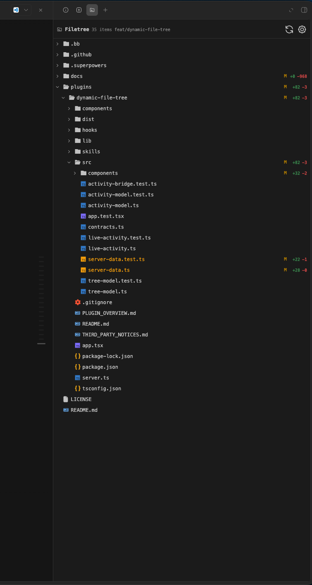

# BB Plugins

[](https://github.com/d-town/bb-plugins/actions/workflows/ci.yml)

Community plugins for [BB](https://getbb.app/), maintained as a public monorepo.
Each plugin is installed independently and can be used without installing the
others.

## Plugins

| Plugin | Description |
| --- | --- |
| [Dynamic File Tree](plugins/dynamic-file-tree/) | Browse the active thread's project tree, Git changes, file metadata, and previews in BB's sidebar. |

## Dynamic File Tree



Dynamic File Tree keeps the project belonging to the active BB thread visible
in a dedicated sidebar tab.

### Features

- Project files and folders, including hidden entries such as `.github` and
  `.vscode`.
- Thread-scoped browsing that follows the active Environment or Worktree.
- Git status, additions, deletions, file size, and modification time.
- Inline previews through BB for text, Markdown, and image files.
- Live highlighting while BB reads or writes files.
- Automatic activity-based folder expansion and collapse.
- Customizable activity, Git, and diff colors.
- Colored file icons for common languages and formats.
- Optional Nerd-Font glyphs and full-path display.

The tree is read-only. Opening a file uses BB's native workspace preview, and
the plugin does not require an account, API key, or external service.

### Installation

Install the plugin directly from this repository:

```sh
bb plugin install git:https://github.com/d-town/bb-plugins.git@main \
  --subdirectory plugins/dynamic-file-tree
```

After installation, open a BB thread with an available Environment or Worktree
and select the Dynamic File Tree tab in the thread sidebar.

### Local development

Work inside the plugin directory:

```sh
cd plugins/dynamic-file-tree
npm install --include=dev
bb plugin types --check
npm test
npm run typecheck
bb plugin build
bb plugin reload dynamic-file-tree
```

The repository contains a collection manifest at `.bb/plugins.json`. Additional
plugins can be added under `plugins/` as independent packages.

## Marketplace

Marketplace publication is planned for a stable release. The plugin already
includes its long-form [`PLUGIN_OVERVIEW.md`](plugins/dynamic-file-tree/PLUGIN_OVERVIEW.md)
and will be submitted to the BB Community marketplace with a versioned Git
release, screenshots, and a dedicated marketplace entry.

## Credits

The interaction concept is inspired by
[`claude-code-filetree`](https://github.com/data-goblin/claude-code-filetree)
by data-goblin. This repository does not copy its code or assets.

## License

This repository is released under the [MIT License](LICENSE).

The Dynamic File Tree plugin also contains a third-party notice file at
[`plugins/dynamic-file-tree/THIRD_PARTY_NOTICES.md`](plugins/dynamic-file-tree/THIRD_PARTY_NOTICES.md).
